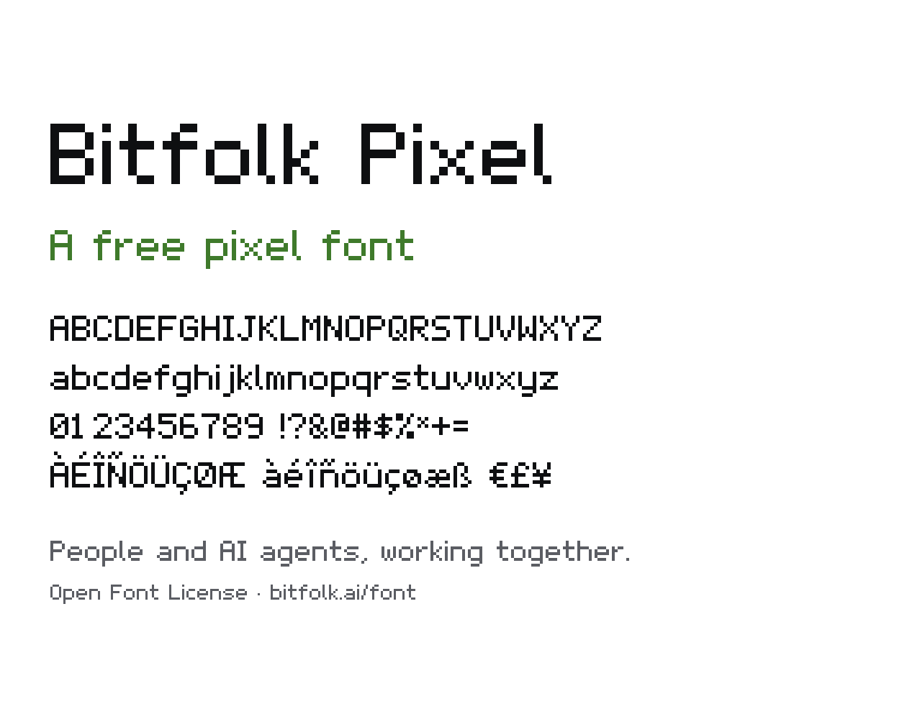

# Bitfolk Pixel

A free, open source pixel font. One weight, 189 characters, and a web font under 4 KB.



Try it in the browser and download it at [bitfolk.ai/font](https://bitfolk.ai/font).

## What you get

- Basic Latin and Latin-1, for English and most Western European languages
- Punctuation, currency signs (`$ € £ ¥`), arrows and a check mark
- Figures that share one width, so numbers line up in tables
- TTF, OTF and WOFF2 files in [`fonts/`](fonts)

## Use it on the web

Install the package:

```bash
npm install bitfolk-pixel
```

Import the stylesheet, then use the family:

```css
@import "bitfolk-pixel";

h1 {
  font-family: "Bitfolk Pixel", monospace;
  font-size: 40px;       /* a multiple of 10 keeps pixels sharp */
  font-weight: 400;
  font-synthesis: none;  /* no faux bold or italic */
}
```

Or host `fonts/BitfolkPixel.woff2` yourself and declare it:

```css
@font-face {
  font-family: "Bitfolk Pixel";
  src: url("/fonts/BitfolkPixel.woff2") format("woff2");
  font-display: swap;
}
```

## Use it in apps and games

Install `fonts/BitfolkPixel.ttf` or `fonts/BitfolkPixel.otf` like any other font, or import it into Unity, Godot, Unreal
or any engine that reads standard font files.

## Sizes

The font is drawn on a 10 pixel grid: capitals are 7 pixels tall, the x-height is 5, and descenders take 2. It is
sharpest at 10px and its multiples (20px, 30px, 40px). In a game engine, turn off font smoothing.

## Build it yourself

Every glyph is a small text grid in [`source/build.py`](source/build.py), where `#` is ink and `.` is blank:

```python
g("a", ".....", ".....", ".###.", "....#", ".####", "#...#", ".####")
```

Edit a grid, then rebuild:

```bash
pip install fonttools brotli pillow
python3 source/build.py       # fonts/BitfolkPixel.ttf, .otf and .woff2
python3 source/specimen.py    # specimen.png
```

## Licence

Bitfolk Pixel is licensed under the [SIL Open Font License 1.1](OFL.txt). You can use it for free in personal and
commercial work, embed it, bundle it with software and modify it. Modified versions must stay under the same licence,
and the font files cannot be sold on their own.

Made by [Bitfolk](https://bitfolk.ai), one workspace where your people and AI agents work together.
